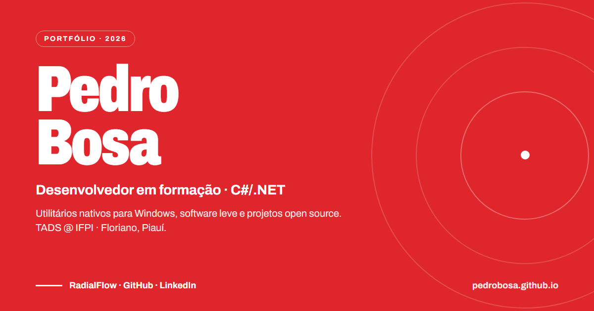

# Pedro Bosa — Portfólio



Portfólio bilíngue de uma página de **Pedro Lucas Ferreira Bosa** ([pedrobosa.github.io](https://pedrobosa.github.io/)), estudante de Análise e Desenvolvimento de Sistemas (TADS) no IFPI Campus Floriano. Desenvolvido com [Astro](https://astro.build) e saída 100% estática, sem nenhum framework JavaScript rodando no cliente.

- Versões em português (`/`) e inglês (`/en/`) geradas a partir de um único template (`HomePage.astro`) e dicionários tipados (`src/i18n/`)
- Cabeçalho flutuante que se transforma em pílula com menu ao rolar a página e menu mobile acessível (`aria-expanded`, `aria-controls`, fechamento por `Escape` e clique externo)
- Hero interativo em `<canvas>`: arraste o mouse para desenhar pinceladas permanentes na tela (duplo clique limpa)
- Seções na ordem **Sobre → Projetos → Stack → Formação → Contato**
- Demonstração em vídeo do **RadialFlow** com poster otimizado em AVIF/WebP via `astro:assets`, respeito a `prefers-reduced-motion` e métricas buscadas da API do GitHub no build (com fallback offline)
- SEO e acessibilidade: `hreflang` recíproco (`pt-BR`, `en`, `x-default`), `canonical`, Open Graph, Twitter Card, JSON-LD `Person` por idioma, sitemap XML, `robots.txt`, skip link e contraste WCAG AA

## Stack do site

- **Framework:** [Astro](https://astro.build/) (SSG estático)
- **Linguagem:** TypeScript (dicionários i18n estritamente tipados e `astro check`)
- **Estilização:** CSS nativo modular com variáveis (`tokens.css`, `base.css`, `components.css`, `layout.css`, `sections.css`) e fontes WOFF2 self-hosted (_Archivo_ e _Source Serif 4_)
- **Imagens e SEO:** `astro:assets` (`<Picture>` com geração de AVIF e WebP) e `@astrojs/sitemap`
- **Qualidade de código:** ESLint (`eslint-plugin-astro`, `typescript-eslint`) e Prettier (`prettier-plugin-astro`)
- **CI/CD:** GitHub Actions (`withastro/action` + `actions/deploy-pages`) e Dependabot

## Como rodar

Requer **Node.js 24 LTS** (ou qualquer versão `>= 22.23.4`, conforme `.nvmrc` e `engines` no `package.json`).

```bash
# 1. Instalar dependências
npm ci

# 2. Iniciar servidor de desenvolvimento (http://localhost:4321)
npm run dev

# 3. Verificar tipos (astro check) e lint (ESLint)
npm run check
npm run lint

# 4. Gerar o build estático em dist/ e testar localmente
npm run build
npm run preview
```

| Comando           | O que faz                                                  |
| ----------------- | ---------------------------------------------------------- |
| `npm run dev`     | Servidor de desenvolvimento com recarga automática         |
| `npm run check`   | Verifica tipos (TypeScript) e templates `.astro`           |
| `npm run lint`    | Analisa o código com ESLint (`eslint-plugin-astro`)        |
| `npm run format`  | Formata os arquivos com Prettier (`prettier-plugin-astro`) |
| `npm run build`   | Gera o site estático em `dist/`                            |
| `npm run preview` | Serve o conteúdo de `dist/` localmente para conferência    |

## Estrutura de pastas

```text
.
├── .github/
│   ├── dependabot.yml                 # atualização semanal de npm e github-actions
│   └── workflows/deploy.yml           # check + lint + build + deploy no GitHub Pages
├── public/
│   ├── cv/                            # currículos em PDF (PT e EN)
│   ├── fonts/                         # Archivo e Source Serif 4 (WOFF2, subset Latin)
│   ├── og/og-image.png                # imagem 1200×630 para Open Graph / Twitter
│   ├── projects/                      # vídeo (MP4/WebM) e poster público do RadialFlow
│   ├── favicon.svg
│   └── robots.txt
├── src/
│   ├── assets/
│   │   └── radialflow-demo-poster.png # poster processado por astro:assets (AVIF/WebP)
│   ├── components/
│   │   ├── layout/                    # Header e Footer
│   │   ├── sections/                  # Hero, About, Projects, Stack, Education, Contact
│   │   ├── ui/                        # Edge (divisores ondulados) e Mesh (malha de fundo)
│   │   └── HomePage.astro             # template único usado por / e /en/
│   ├── data/
│   │   ├── site.ts                    # perfil, links e busca de métricas na API do GitHub
│   │   └── nav.ts                     # ordem das seções no menu e âncoras
│   ├── i18n/
│   │   ├── pt.ts                      # textos em português (define o tipo Dictionary)
│   │   ├── en.ts                      # textos em inglês (tipado por Dictionary)
│   │   └── index.ts                   # helpers t(), routes e altLang()
│   ├── layouts/Layout.astro           # <head>, SEO, hreflang, JSON-LD, header e footer
│   ├── pages/
│   │   ├── index.astro                # rota /     (PT-BR)
│   │   ├── en/index.astro             # rota /en/  (EN)
│   │   └── 404.astro                  # página 404
│   └── styles/
│       ├── global.css                 # ponto de entrada de estilos
│       ├── fonts.css                  # @font-face self-hosted
│       ├── tokens.css                 # variáveis de cor, tipografia e espaçamento
│       ├── base.css                   # reset, tipografia base e skip link
│       ├── components.css             # botões, links, listas e tons de seção
│       ├── layout.css                 # cabeçalho flutuante, menu mobile e rodapé
│       └── sections.css               # estilos de cada seção
├── .nvmrc                             # versão do Node.js (24)
├── .prettierrc                        # configuração do Prettier
├── astro.config.mjs                   # domínio, sitemap e i18n
├── eslint.config.mjs                  # configuração flat do ESLint
├── package.json
└── tsconfig.json
```

## Como o deploy funciona

O deploy no **GitHub Pages** é automatizado pelo workflow [`.github/workflows/deploy.yml`](.github/workflows/deploy.yml):

1. **Gatilhos:** executa a cada `push` na branch `main`, semanalmente via `schedule` (`cron: '0 6 * * 1'`) para atualizar estrelas, forks e versão do RadialFlow automaticamente, ou manualmente via `workflow_dispatch`.
2. **Validação:** configura o Node.js a partir do `.nvmrc`, instala as dependências com `npm ci` e executa `npm run check` (`astro check`) e `npm run lint` (`eslint .`) antes do build.
3. **Build e publicação:** constrói o site estático e empacota o artefato com `withastro/action` (injetando `GITHUB_TOKEN` para consultar a API do GitHub sem sofrer rate limit; se a API falhar, `src/data/site.ts` usa `FALLBACK_STATS` para nunca quebrar o build) e publica com `actions/deploy-pages` sob permissões mínimas (`contents: read`, `pages: write`, `id-token: write`).

## Licença

Código-fonte disponível para estudo e referência. Todos os direitos sobre a identidade pessoal, textos biográficos e currículos pertencem a **Pedro Lucas Ferreira Bosa**.
